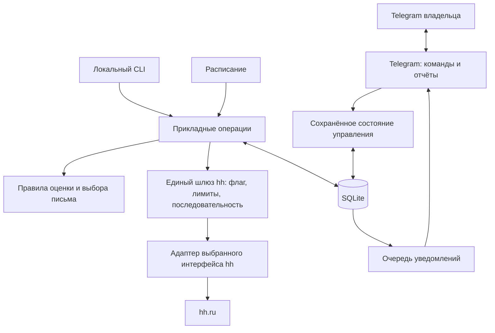

# Архитектура и стек

Дата: 29 октября 2026. Статус: выбранная техническая основа для разработки; поведение внешних интерфейсов ещё требует исследования. Бизнес-требования задаёт [документ решений](05-automation-decisions-2026-10-28.md). Этапы — в [плане](DEVELOPMENT-PLAN.md), неопределённости — в [открытых вопросах](OPEN-QUESTIONS.md).

## 1. Общий подход

Один Python-процесс на одной машине, один аккаунт hh, один владелец Telegram и одна локальная SQLite. Управление через Telegram, диагностика и обслуживание через CLI. Это обычное приложение с несколькими модулями, без отдельного HTTP-сервера, брокера, Redis, PostgreSQL и контейнерной инфраструктуры на первом этапе.

В процессе параллельно работают Telegram long polling, расписание, доставка уведомлений и один исполнитель hh-операций. Асинхронность нужна для отзывчивости управления во время ожидания сети; сами обращения к hh последовательны. Мониторинг и поиск используют того же исполнителя и тот же контроль доступа.



Схема показывает границы ответственности. Порядок получения и обработки выдачи будет конкретизирован после исследования 06; документ не фиксирует неподтверждённый способ поиска или схему БД.

## 2. Стек

| Задача | Выбор | Причина |
| --- | --- | --- |
| Язык | Python 3.14, актуальный исправленный patch-релиз | Подходит для сетевых интеграций, текстовых правил и SQLite. Ветку фиксируем в `.python-version` при создании каркаса. |
| Среда и зависимости | `uv`, `pyproject.toml`, `uv.lock` | Одна изолированная среда и воспроизводимая установка; lock-файл в Git. |
| Сеть | `httpx.AsyncClient` | Один HTTP-клиент для каждого сервиса, явные таймауты и тестовые транспорты. Политики повторов задаём отдельно для hh и Telegram. |
| Telegram | Небольшой адаптер Bot API поверх HTTPX | Нужны long polling и несколько методов: `getMe`, `getUpdates`, `sendMessage`; большой бот-фреймворк пока не нужен. |
| Хранение | Стандартный `sqlite3`, SQL-миграции по номерам | База без отдельного сервера; SQL остаётся явным. ORM и Alembic для этого объёма не требуются. |
| Конфигурация | TOML + `tomllib`, переменные окружения для секретов | Читаемые настройки без дополнительного парсера; проверка типов, диапазонов и обязательных полей при старте. |
| Модели и правила | `dataclasses`, `enum`, обычные Python-функции | Простая типизация, объяснимость и тестирование без сети. Входной JSON валидируется адаптером, а не слепо передаётся в модели. |
| Время | `datetime`, `zoneinfo`, пакет `tzdata` | UTC в хранилище, Europe/Moscow для расписания и границ дня; tzdata нужен в том числе для Windows. |
| Расписание | `asyncio` и расчёт ближайшего из пяти слотов | Для фиксированных ежедневных запусков достаточно небольшой функции с подменяемыми часами. |
| Единственный экземпляр | `portalocker` | Межпроцессная блокировка с поддержкой Windows и Linux; наличие PID-файла само по себе блокировкой не считается. |
| CLI и логи | `argparse`, `logging` | Стандартной библиотеки достаточно. Ротация и фильтрация секретов обязательны. |
| Проверки | `pytest`, `ruff` | Тесты правил, отказов и границ интеграций; форматирование и базовый статический анализ. Async-сценарии сначала запускаем через `asyncio.run`. |

Начальные внешние runtime-зависимости: HTTPX, tzdata, portalocker. Если выбранная интеграция hh требует SDK или MCP-клиент, добавляем его после исследования с проверкой лицензии и зависимостей. Ни готового программного доступа по ID резюме, ни возможности заменить существующую интеграцию прямым HTTP пока не предполагаем.

На текущей машине обнаружен Python 3.12.10. Переустанавливать системный Python не требуется: при реализации создадим отдельную среду проекта с выбранной версией. В этой задаче зависимости не устанавливались.

## 3. Структура кода

Планируемая структура; пустые модули заранее не создаём:

```text
docs/                         требования, архитектура, план, вопросы
src/hh_vacancy_service/
    __main__.py               CLI и сборка приложения
    config.py                 чтение и проверка конфигурации
    models.py                 внутренние типы и ошибки
    control.py                on/off, режим, причина паузы
    scheduler.py              слоты и единственный активный обход
    service.py                прикладные операции и их порядок
    scoring.py                оценки трёх профилей и объяснения
    letters.py                выбор и безопасное заполнение шаблонов
    applications.py           отправка и сверка результата; после исследования
    monitoring.py             сравнение доступных статусов и событий
    reports.py                читаемые отчёты и разбиение на части
    storage.py                короткие транзакции и запросы
    hh.py                     шлюз и конкретный адаптер hh
    telegram.py               команды, транспорт, доставка
    migrations/               нумерованные SQL-миграции
tests/                        синтетические и обезличенные сценарии
config.example.toml           пример без ID, секретов и личных фактов
pyproject.toml
uv.lock
```

Делим модуль на папку только при реальной необходимости. Направление зависимостей: CLI/Telegram → прикладные операции → правила и адаптеры. Функции оценки не знают о HTTP, Telegram и SQL. Адаптер hh возвращает структурированные результаты, а не готовый текст отчёта и не первые шесть строк списка.

Персональные настройки, подтверждённые профили, реальные письма и соответствия ID хранятся в локальном каталоге данных, исключённом из Git. В репозитории — форматы и вымышленные примеры. Снимки использованного содержания и версии правил должны позволять восстановить конкретное решение после последующих правок.

## 4. Управление и выполнение

Есть два независимых измерения:

- **Доступ к hh:** enabled/disabled с сохранённой причиной остановки. При первой инициализации disabled; далее восстанавливаем сохранённое состояние.
- **Режим:** dry-run, pilot, automatic. По умолчанию dry-run. `/on` разрешает hh-работу в текущем режиме, но не переводит приложение в автоматическую отправку.

Dry-run может читать hh после `/on`, оценивать и формировать отчёты, но не вызывает отправку. Pilot допускает только заранее выбранные и явно подтверждённые вакансии; способ ввода такого подтверждения — локальный CLI с предпросмотром, без добавления новых Telegram-команд в требования. Automatic включается отдельно после приёмки. Исследовательский CLI по умолчанию использует фикстуры; живое чтение подчиняется тому же флагу и блокировкам. Подтверждение владельца — разрешение на действие, а подтверждение hh — доказательство его результата; это разные события.

Единый шлюз hh проверяет непосредственно перед каждым запросом сохранённый флаг, лимиты и состояние сессии. При выдаче разрешения на запрос не должно быть асинхронного ожидания между последней проверкой флага и стартом запроса. Обработчик `/off` сохраняет состояние и отвечает, не ожидая завершения всего обхода. Уже начатый запрос завершается и фиксируется; следующий запрещён. Чисто локальная обработка и доставка отчёта продолжаются. Внутренние скрытые запросы SDK тоже должны проходить этот контроль; неподконтрольный авто-retry SDK неприемлем.

Telegram принимает команды только в личном чате при совпадении `from.id` и `chat.id` с настройками владельца. `update_id` и результат изменения состояния сохраняются до подтверждения обработки обновления. Повторное получение команды не должно повторно менять состояние. Политика старых команд `/on`, накопившихся за время простоя, вынесена в Q-10; безопасная рекомендация — старые `/on` не включают hh, `/off` применяем всегда.

Расписание использует 09:00, 12:00, 15:00, 18:00, 21:00 Europe/Moscow. После `/on` или рестарта выбирается ближайший будущий слот; пропущенные слоты не превращаются в очередь обходов. Если один обход ещё работает, следующий не создаёт второй. При очередном сборе применяется правило текущего московского дня, а не перенос вчерашней очереди. Размер перекрытия, поведение обновлённых публикаций и прогресс по каждому источнику/профилю определяются исследованием. Неполная пагинация не должна выглядеть успешным полным обходом и продвигать общий успешный курсор.

В Windows Task Scheduler запускаем долгоживущий процесс при входе/старте с восстановлением после падения. Пять обходов назначает сам процесс: отдельные пять системных задач мешали бы постоянно работающим Telegram-командам. Принцип запуска отличается от базового проекта и является техническим выбором этого плана. Вопрос непрерывной работы машины — Q-04.

## 5. Хранение и восстановление

SQLite располагается на локальном диске вне синхронизируемой сетевой папки. Включаем foreign keys, ограниченный busy timeout; режим WAL и настройки надёжности проверяем при реализации. Короткие SQL-операции выполняются последовательно; транзакция никогда не охватывает HTTP-запрос. Долгие дисковые операции не должны блокировать приём `/off`: используем отдельное соединение и фоновый поток, где это необходимо.

Сейчас выбираем механизм хранения и требования к целостности. Таблицы, поля, индексы и финальная модель состояний появятся после согласования данных и проверки источников — Q-03 и этап P0. Состав сохраняемой информации уже описан в исходном документе решений; не сокращаем его до одного URL и итоговой оценки.

Обязательные свойства будущего хранилища:

- Решения связаны с неизменяемыми снимками вакансии, резюме, правил и письма. Хранятся три оценки, причины, пропуски, ручные вмешательства и доступность данных.
- Отклик и доставка отчёта независимы. Изменение локального состояния и создание уведомления сохраняются одной транзакцией: перезапуск не теряет сообщение.
- До сетевой отправки сохраняется намерение и резервируется лимит. Проверка дубля, резерв и намерение атомарны; уникальные ограничения — дополнительная защита помимо одного процесса.
- Один аккаунт не получает второй отправки на тот же vacancy ID с другим резюме. Незавершённая или неопределённая попытка тоже блокирует повтор до сверки. Републикация с новым ID — подозрение на дубль для ручной проверки.
- В счётчиках попыток учитываются зарезервированные и неопределённые отправки: сбой не освобождает лимит автоматически. Проверяются обход, календарные сутки Москвы и скользящие 24 часа.
- Время попытки, подтверждения, наблюдения и исходного события различается. Неполная история и архивы явно отмечены; импорт ручных откликов не выдаётся за полный журнал.
- Используем нумерованные миграции с журналом применённых версий. при ошибке миграции hh-работа не запускается.

Доставка Telegram имеет повторные попытки с задержкой и сохранённым временем следующей попытки. После неоднозначного ответа Telegram возможен повтор уведомления; стабильные ID отчёта и номера частей помогают его распознать. Гарантировать единственную доставку внешнего сообщения нельзя. Повтор Telegram никогда не вызывает повтор отклика. Для вакансий ниже порога сохраняется факт включения в уведомление и очередь доставки, чтобы очередной обход не создавал новый такой же отчётный элемент.

Историю храним без автоматического удаления; очистка — по указанию Семёна. Резервные копии не создаём.

## 6. Внешние ошибки и неопределённость

Для hh сетевые таймауты ограничены; автоматических транспортных повторов отправки нет. 403, 429, капча, лимит, неожиданная структура ответа и повторные ошибки приводят к сохранённой паузе и критическому уведомлению. После устранения причины требуется явный `/on`. Повторы read-only запросов допустимы только по проверенной политике источника и после проверки флага; не продолжаем листание после ограничения.

Таймаут или падение после начала отправки оставляет результат неопределённым. После запуска сначала сверяем незавершённые попытки с доступной историей hh. Отсутствие записи в неполном списке не доказывает, что отклика не было; повтор не выполняется. Успех ставится только по проверяемому свидетельству повторного чтения; если итоговый текст письма проверить нельзя, это ограничение сохраняется и результат не объявляется полностью подтверждённым.

Если обязательную форму невозможно проверить до отправки, это ручной случай. Возможности адаптера описываются явно: поиск по профилю, даты, пагинация, история/архивы, проверка форм и письма, сообщения и побочные эффекты чтения. Неподдерживаемая возможность не подменяется догадкой.

Для Telegram 429 учитываем `retry_after`, при недоступности сохраняем очередь и ограничиваем частоту повторов. Отчёты отправляем обычным текстом с целыми URL, нумеруем части и оставляем запас до 4096 символов, учитывая Unicode. Длинный элемент сокращается по названию/объяснению; ссылка остаётся целой. В логах не пишем полный URL Bot API с токеном, заголовки авторизации, cookies, содержимое сессии и персональные тела ответов.

## 7. Эксплуатация и границы первой версии

По решению Семёна от 29 октября (Q-04) разрабатываем и проверяем сервис локально до завершения, затем разворачиваем на VPS; доступ будет предоставлен на этапе деплоя. Начальный запуск — Windows и локальный диск; код переносим на Linux без изменения правил, ОС и способ запуска VPS уточняем при развёртывании. Веб-панель, многопользовательский режим, отправка сообщений работодателям, LLM-ранжирование и аналитический дашборд в первую версию не входят. Ручной анализ делается по сохранённым данным, доступ к ним — локально.

CLI предусматривает диагностику конфигурации без раскрытия значений секретов, просмотр состояния, одиночный dry-run, работу с ручной очередью, проверку конкретной неопределённой попытки. Мутирующие команды при запущенном сервисе не запускают второй исполнитель: на первом этапе требуют штатно остановленного процесса и того же межпроцессного lock. Реальное hh-чтение при этом всё равно проверяет saved enabled. Read-only локальные команды не включают hh.

## 8. Документация технологий

Проверено по официальным источникам 29 октября 2026; точные версии зависимостей выбираются и фиксируются при P1.

- [Python: версии и поддержка](https://devguide.python.org/versions/) — основание выбора поддерживаемой ветки 3.14.
- [HTTPX: асинхронный клиент](https://www.python-httpx.org/async/) — работа через AsyncClient.
- [Python sqlite3](https://docs.python.org/3.14/library/sqlite3.html) — транзакции.
- [Python zoneinfo](https://docs.python.org/3.14/library/zoneinfo.html) — зоны времени и tzdata для Windows.
- [uv: lock и sync](https://docs.astral.sh/uv/concepts/projects/sync/) — воспроизводимая среда.
- [Telegram Bot API](https://core.telegram.org/bots/api) — getUpdates, sendMessage, ограничения и ошибки.
- [Portalocker](https://portalocker.readthedocs.io/en/latest/) — межпроцессные файловые блокировки.


## Уточнения Семёна

Статусы и сообщения проверяем во время пяти обходов. Вакансии, оценки с причинами, выбранное резюме, письмо, отклики и доступные ответы сохраняем без автоматического удаления; бэкапы не делаем. При равных оценках выбираем по направлению, навыкам и заданному порядку резюме. Выбираем первый подходящий шаблон. После проверки нескольких десятков вакансий запускаем ограниченный автоматический пилот без согласования каждой вакансии. Эти решения заменяют противоречащие старые пункты.
